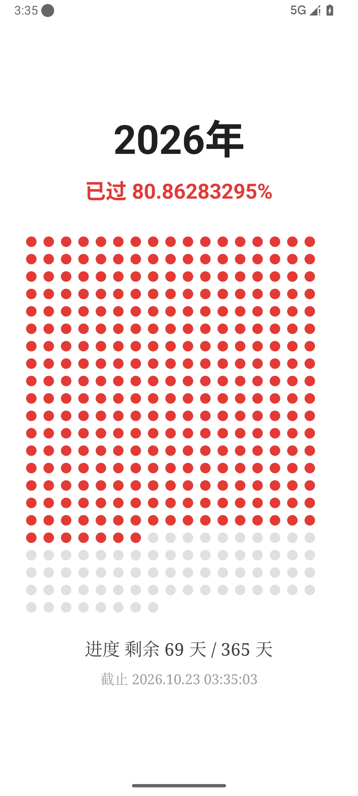
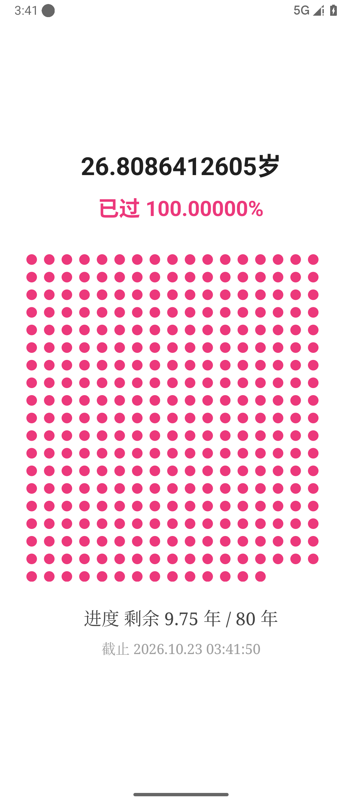
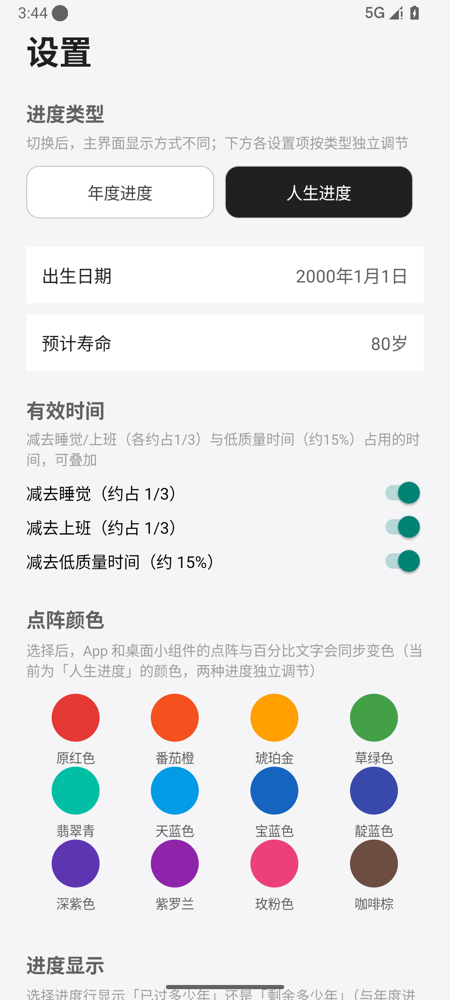
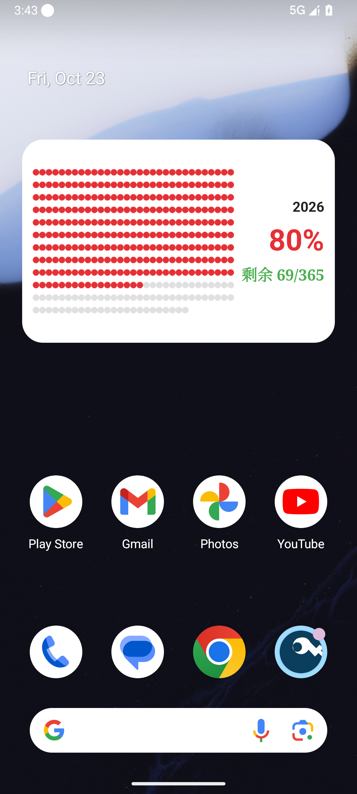

# 年度进度（YearProgress）

把一年 365 天（闰年 366 天）变成一张看得见的点阵图：每天一个点，已经走过的日子用彩色实心点点亮，剩下的日子保持灰色空心，年度进度一目了然。App 每秒实时刷新，跨过凌晨 0 点自动加一天，跨年自动切换到新一年。

> 仓库：<https://github.com/luooooooooo/YearProgress>

## 功能特性

- **点阵主界面**：365/366 个点自动按屏幕宽度排成网格，彩色实心点 = 已过天数，灰色空心点 = 剩余天数
- **实时进度**：已过百分比精确到 8 位小数、每秒刷新；同时显示「已过/剩余」天数与精确到秒的截止时间
- **双模式**：年度进度 / 人生进度可自由切换，两组设置（颜色、进度显示、扣减项）完全独立存储、互不联动
- **人生进度**：年龄精确到小数点后 10 位、每秒变化；点阵按每季度一个点（恒定 320 点）按有效寿命等比缩放；支持自定义出生日期（默认今天）与预计寿命（默认 80 岁，最低当前年龄、最高 800 岁，可手输或滑动）
- **有效时间**：可叠加扣除「睡觉 1/3」「上班 1/3」「低质量时间 15%」，百分比与点阵均按扣减后的有效寿命重算，百分比封顶 100%
- **桌面小组件（4×2）**：两个独立小组件「年度进度」（365 点点阵 + 年份 + 百分比 + 天数）与「人生进度」（320 点点阵 + 年龄 + 百分比 + 年数），点阵按小组件实际尺寸等比生成、圆点饱满不变形；颜色与进度显示方式各自跟随对应模式设置；点击小组件直达 App 并自动切换模式
- **12 色主题**：原红色 / 番茄橙 / 琥珀金 / 草绿色 / 翡翠青 / 天蓝色 / 宝蓝色 / 靛蓝色 / 深紫色 / 紫罗兰 / 玫粉色 / 咖啡棕，年度与人生各自独立记忆，App 与小组件同步变色
- **进度显示切换**：进度行可切换「已过多少」或「剩余多少」（年度按天、人生按年，各自独立）
- **零权限、零依赖、纯本地**：不联网、无广告、无权限申请，所有计算基于系统时间实时推导

## 截图

| 年度主界面 | 人生进度 | 设置页 | 桌面小组件 |
| :---: | :---: | :---: | :---: |
|  |  |  |  |

## 更新记录

### 2026-10-23 · v1.4 · 独立「人生进度」桌面小组件（本次更新）

- 桌面小组件拆分为**两个独立类型**：「年度进度」小组件（固定显示年度数据）与「人生进度」小组件（固定显示人生数据），可在桌面同时放置、互不影响
- 人生进度小组件：4×2 长方形卡片，显示年龄 / 已过百分比 / 320 点点阵（每季度 1 点，32 列 × 10 行，正圆饱满不变形）/ 剩余或已过年数；数据只来自 App 的「人生进度」设置
- 两个小组件的颜色、进度显示方式均与各自模式设置保持同步：修改「人生进度」颜色，人生小组件变色、年度小组件不受影响（反之亦然）
- 点击小组件直达 App 并自动切换到对应模式：点年度小组件进入年度进度，点人生小组件进入人生进度
- 无论 App 内如何切换模式，已放置的小组件都保持自己固定的进度类型

### 2026-10-23 · v1.3.3 · 统一有效时间扣减口径

- 三个扣减开关算法统一：剩余寿命 = 预期寿命 − 当前年龄；扣减 = 剩余寿命 × 比例（睡觉 1/3、上班 1/3、低质量 15%）；有效剩余 = 剩余寿命 − 扣减之和
- 已过百分比与点阵 = 当前年龄 ÷ (当前年龄 + 有效剩余)，不开任何开关时退化为「当前年龄 ÷ 预期寿命」
- 示例：2000-01-01 出生、预期 80 岁 → 不开约 33.5% / 剩余 53.19 年；只开睡觉约 43.1% / 剩余 35.46 年；三项全开约 73.3% / 剩余 9.75 年

### 2026-10-23 · v1.3.2 · 修正有效时间扣减口径

- 扣减量改为按「已过时间 / 剩余时间」分别计算：减去睡觉 = 已过年龄 × 1/3（已睡掉的时间）；减去上班 = (预期寿命 − 当前年龄) × 1/3；减去低质量时间 = (预期寿命 − 当前年龄) × 15%
- 有效寿命 = 预期寿命 − 各扣减量之和；已过百分比与点阵均按有效寿命重算（封顶 100%）
- 示例：2000-01-01 出生、预期 80 岁、三项全开 → 已过约 59.1%、剩余约 18.55 年（旧口径为 100% / 9.75 年）

### 2026-10-23 · v1.3.1 · 出生日期逐年快速选择

- 出生日期选择器由日历翻页改为「年/月/日」三列数字滚轮：年份可直接快速滑动跳转到任意一年（一次滑动约 4~5 年），不再逐月翻日历
- 年份/月份变化时自动联动当月最大天数（避免 2 月 30 日等非法日期）；选择晚于今天的日期会自动截断到今天并提示

### 2026-10-23 · v1.3 · 人生进度

- 新增「人生进度」模式：设置页可切换年度/人生，人生模式下按出生日期实时计算年龄（10 位小数、每秒刷新）、已过百分比（封顶 100%）与恒定 320 点季点点阵
- 新增出生日期选择（默认今天，不可选未来）与预计寿命调节（默认 80 岁、最低当前年龄、最高 800 岁，支持手输与滑动）
- 新增「有效时间」：可叠加扣除睡觉（1/3）、上班（1/3）、低质量时间（15%），百分比与点阵均按有效寿命重算
- 年度与人生两组设置（颜色、进度显示）完全独立存储，互不联动
- 小组件点阵更饱满（圆点相切铺满、权重加宽）
- 修复：设置页首次进入未按模式渲染人生区块的显示问题

### 2026-10-23 · 自动构建与发布

- 新增 GitHub Actions 工作流：每次推送 `main` 分支后自动构建 Debug APK，并上传到仓库 Release（`latest`）
- 以后每次更新只需 push，即可自动产出可安装的最新 APK

### 2026-10-23 · v1.2

- 新增设置页：12 色点阵颜色选择、进度显示方式切换（已过/剩余）、衬线字体排版
- 新增 4×2 桌面小组件：点阵按小组件实际尺寸等比生成不拉伸，设置变更即时同步刷新
- 设置项由 App 与小组件共用同一份偏好

## 技术栈与构建

- Kotlin 2.1.0 · Android Gradle Plugin 8.11.1 · Java 17
- minSdk 24（Android 7.0）· targetSdk 35 · 无任何第三方依赖（仅 Kotlin 标准库）
- 主界面点阵为自绘 View（Canvas），小组件使用 RemoteViews + 预渲染位图

构建 Debug APK：

```bash
./gradlew assembleDebug
```

产物路径：`app/build/outputs/apk/debug/app-debug.apk`

## 安装

- 直接从仓库 Release 下载最新的「最新 APK（Debug）」安装到 Android 7.0 及以上设备
- 覆盖安装旧版本时如提示签名不一致，卸载后重新安装即可
